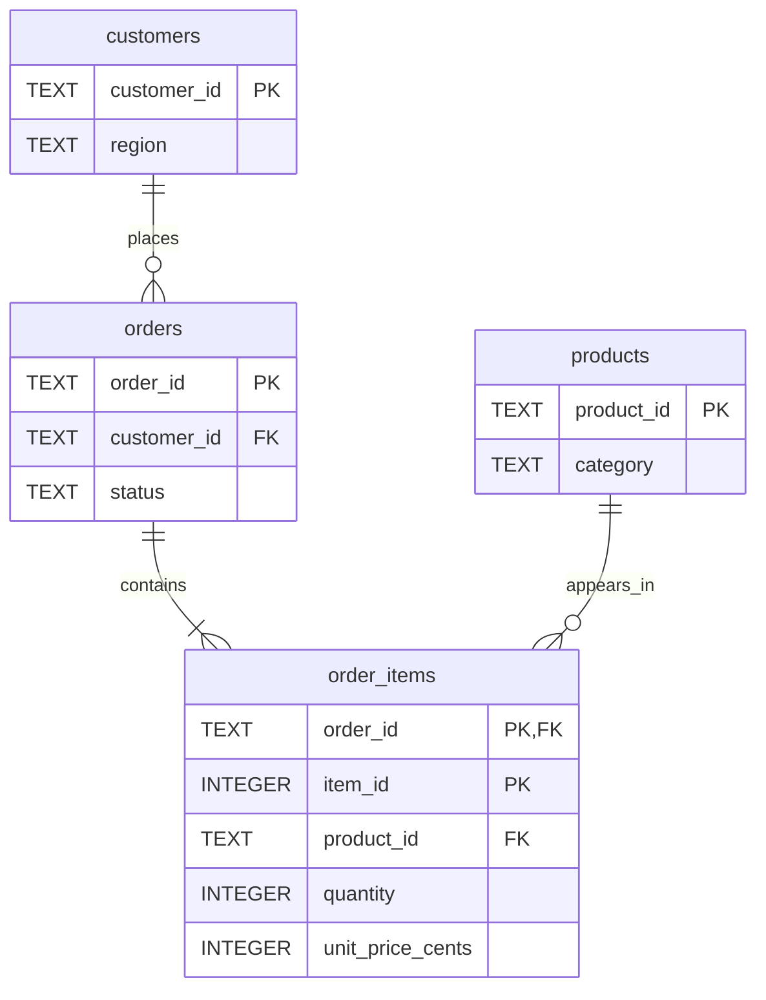

# Input data contract

Each input directory contains these four UTF-8 CSV files. Column order must
match the sample headers. All fields are required except `delivered_at` for
non-delivered orders. Leading and trailing whitespace is stripped.

| File | Grain / key | Fields |
|---|---|---|
| customers.csv | One customer / customer_id | customer_id, region |
| products.csv | One product / product_id | product_id, category |
| orders.csv | One order / order_id | order_id, customer_id, status, ordered_at, estimated_delivery_at, delivered_at |
| order_items.csv | One order line / (order_id, item_id) | order_id, item_id, product_id, quantity, unit_price_cents |

- IDs are nonempty strings, except `item_id`, which is a positive integer.
- Use a stable customer identifier across purchases, not an order-specific account ID.
- `quantity` is a positive integer; `unit_price_cents` is a nonnegative integer.
- All money must use the same currency, with 100 minor units per major unit.
- Dates use `YYYY-MM-DD`. Time-of-day and timezone analysis are out of scope.
- Supported statuses: `delivered`, `shipped`, `cancelled`.
- Delivered orders require a delivery date; other statuses require it to be blank.
- Estimated and actual delivery dates cannot precede the order date.
- Every order must have at least one item, including cancelled and shipped orders.
- Foreign keys must resolve; duplicate keys are rejected, not deduplicated silently.
- Every file must have at least one data row. Empty analysis populations still
  produce report headers, and rates with no denominator are null.

The sample contains four customers, three products, six orders, and seven
order lines. Regions and amounts are fictional and deliberately small enough
to verify manually. Never present this fixture as Malaysian market data.

For a source with additional statuses or timestamp fields, create an explicit
adapter with documented mappings rather than discarding unsupported records.

## CSV formatting

Use commas as separators and keep the header names and order exactly as listed
above. UTF-8 files with or without a byte-order mark (BOM) are accepted.

Wrap a field in double quotes when it contains a comma, double quote, or line
break. Inside a quoted field, write a literal double quote twice:

```csv
product_id,category
P001,"Home, garden"
P002,"Books ""special edition"""
```

These categories load as `Home, garden` and `Books "special edition"`.
Unclosed quotes and unexpected text after a closing quote are rejected.
When generating CSVs in Python, use `csv.writer` or `csv.DictWriter` with
`newline=''` and `encoding='utf-8'` instead of joining values with commas.

For a shipped or cancelled order, keep the final delivery-date column empty;
the trailing comma is required when using the unquoted form:

```csv
order_id,customer_id,status,ordered_at,estimated_delivery_at,delivered_at
O001,C001,shipped,2025-01-01,2025-01-05,
```

Do not substitute `NULL`, `None`, or `N/A` for a blank date. Required
fields containing only whitespace are rejected. For validation errors that
include a line number, it is the physical ending line of the CSV record;
a quoted multiline field can span more than one line.

These snippets illustrate individual files, not a complete input dataset.
Matching customers, products, orders, and order items are still required.

## Preserving identifiers

Treat `customer_id`, `product_id`, and `order_id` as text throughout source
preparation. For example, `00123` and `123` are different identifiers, and
`C001` and `c001` are different identifiers. References across the four CSVs
must use the same spelling and case.

The loader strips surrounding whitespace: ` C001 ` becomes `C001`.
Two source IDs that differ only by surrounding whitespace therefore collide
after loading and trigger a duplicate-key error. Investigate the source
instead of silently dropping one of those records.

The exception is `item_id`, which is an integer within each order:
`01` and `1` both become 1 and cannot identify separate lines of the same
order. If a source uses text line IDs, create and document a mapping to
positive integers that stays unique within each order.

## Preparing monetary values

Store the price of one unit in `unit_price_cents`; the pipeline multiplies it
by `quantity` to calculate each line's value. For example, three units priced
at 19.99 each must use:

```csv
order_id,item_id,product_id,quantity,unit_price_cents
O001,1,P001,3,1999
```

This line contributes 5,997 minor units (59.97) to the order. Do not put the
line total `5997` in `unit_price_cents`, or quantity will be applied twice.
Decimal strings such as `19.99` and currency symbols are rejected in integer
columns.

When adapting a decimal-price source, use decimal arithmetic and document
how amounts with more than two decimal places are rounded. Convert to minor
units before writing the CSV. Keep one currency across all four input files;
the schema has no currency field or exchange-rate conversion.

## Table relationships



The diagram highlights keys and analysis fields; the table above lists every
input column. Customers and products can exist without orders or items.
Every order must have at least one item: the loader checks this rule after
insertion, while SQLite foreign keys enforce the references.

## Choosing the correct row level

Use `order_summary` for order counts, average order value, and delivery
metrics. It aggregates item values before joining them to orders, leaving
one row per order.

Use `order_items` joined to `products` for category and unit analysis.
The item key is the pair `(order_id, item_id)`; `item_id` alone is not unique
across orders.

For example, an order containing two item rows becomes two rows when joined
directly to `order_items`. Counting those joined rows would count the order
twice. A distinct order count fixes that count, but averaging delivery days
over the joined rows still overweights orders with more items. Calculate
delivery averages from `order_summary` instead.

Source of truth: [the SQL schema](../sql/schema.sql).
